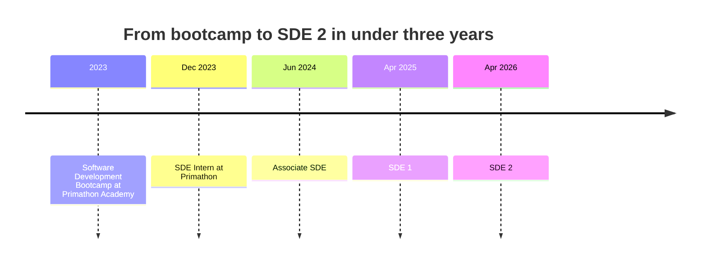

 

---

## 👋 About me

I'm a full-stack software engineer with 3+ years of experience, based in Gurugram, India. I own features end to end, from MySQL schemas and backend APIs to the UI, across commerce, fintech and document-processing platforms, and I like turning ambiguous requirements into clean, scalable systems.

- 🛒 Frontend lead on **Ratio**, a multi-tenant commerce platform. I've shipped storefronts for 7+ brands, plus **Cardify**, a drop-in product-card app that is live on 16 storefronts.
- 🤖 I build AI-augmented engineering tools: multi-agent pipelines, MCP servers and approval-gated automation.
- ⚙️ Strong on the backend: I design and ship APIs in Node.js / NestJS / Express and Python / FastAPI, model data in MySQL, build SSO and secure auth, and own AWS + Docker deployments.
- ⚛️ And on the front: React and Next.js (App Router), TypeScript and Tailwind, with a focus on performance (100% Lighthouse scores on multiple production pages).

## ⚙️ Backend & architecture

| | What I've built and owned |
|---|---|
| **APIs and services** | Node.js / NestJS / Express and Python / FastAPI services, BFF proxy layers over multi-service backends, and multi-tenant architecture |
| **Data** | MySQL schema design and query optimisation for a large-scale document-upload platform, plus MongoDB |
| **Auth and security** | Single Sign-On across frontend and backend, and secure custom document rendering |
| **AI and document pipelines** | Backend APIs for large-scale PDF processing that structure financial documents for LLM pipelines, working with an AI team to lift response accuracy to 85–90% |
| **Migrations and integrations** | Discount and reviews migration APIs that pull live data from Shopify into a custom data model with zero loss, plus a custom order-confirmation package, front and back |
| **Cloud and delivery** | AWS (S3 and deployments), Docker containerisation in production, and CI/CD |

## 🧰 Tech stack

## 🛣️ Career journey

## 🏢 Built at work

<table>
<tr>
<td width="50%" valign="top">

### 🛒 Ratio
Multi-tenant Next.js commerce platform. A widget-based page builder with a visual editor, Shopify data-migration APIs, custom order-confirmation flows and SEO infrastructure, powering storefronts for 7+ brands.

  

</td>
<td width="50%" valign="top">

### 🃏 Cardify
A drop-in app that swaps a storefront's product cards for one of five designs from a single admin switch. Fails safe to the native cards. **Live in production on 16 storefronts.**

  

📖 [Read the write-up](https://aniq-haider.vercel.app/blog/cardify)

</td>
</tr>
<tr>
<td width="50%" valign="top">

### 🤖 Agent cloning pipeline
Five specialised Claude Code agents that turn a live URL or a Figma frame into build-verified UI, one section at a time, and learn from every run.

 

📖 [Read the write-up](https://aniq-haider.vercel.app/blog/agent-cloning-pipeline)

</td>
<td width="50%" valign="top">

### 🔌 github-repo-mcp
A local MCP server that clones, maps, searches and reads any GitHub repo on demand, with a tree-sitter symbol map and ripgrep search.

 

📖 [Read the write-up](https://aniq-haider.vercel.app/blog/github-repo-mcp)

</td>
</tr>
<tr>
<td width="50%" valign="top">

### 🛡️ Editor update system
A safe workflow for changing a visual editor's template data through its APIs: reads are free, every write needs human approval, and deletes are backed up first.

 

📖 [Read the write-up](https://aniq-haider.vercel.app/blog/editor-update-system)

</td>
<td width="50%" valign="top">

### 💼 Fintech and documents
**Axis Robo Advisory:** AI-driven widget rendering, PDF-processing APIs for LLM pipelines, cross-stack SSO and Docker.
**Documitra:** MySQL design for large-scale uploads, AWS infrastructure, notifications and payments.

  

</td>
</tr>
</table>

## 🚀 Open projects

<table>
<tr>
<td width="50%" valign="top">

### 🌐 [qweek-ui](https://github.com/AniqHaider/qweek-ui)
Paste a URL and get a self-contained Tailwind HTML clone of its homepage, rendered live as it generates. Generation runs through the `claude` CLI.

  

</td>
<td width="50%" valign="top">

### 🥋 [backend-dojo](https://github.com/AniqHaider/backend-dojo)
A hands-on backend practice app (Python + PostgreSQL) with verified exercises, a growing architecture diagram and an AI tutor. Svelte + FastAPI.

  

</td>
</tr>
<tr>
<td width="50%" valign="top">

### 📱 [prep-pocket](https://github.com/AniqHaider/prep-pocket)
An offline Android app combining Backend Dojo, Svelte/TypeScript prep and JS drills. Svelte 5 + Capacitor.

 

</td>
<td width="50%" valign="top">

### 🧩 [no-c0de-platform](https://github.com/AniqHaider/no-c0de-platform)
A visual pipeline builder with a React frontend and a FastAPI backend, where you compose workflows from nodes.

 

</td>
</tr>
<tr>
<td width="50%" valign="top">

### 💬 [Electron-chatbot-desktop-app](https://github.com/AniqHaider/Electron-chatbot-desktop-app)
A cross-platform desktop chat app with real-time streaming Gemini AI responses and conversations stored in MongoDB.

  

</td>
<td width="50%" valign="top">

### 🎓 Interview prep apps
[**svelte-typescript-prep**](https://github.com/AniqHaider/svelte-typescript-prep): 100 MCQs with explanations and theory tabs.
[**stock-company-prep**](https://github.com/AniqHaider/stock-company-prep): gap analysis, stories and JS/TS drills in a SvelteKit PWA.

 

</td>
</tr>
</table>

## ✍️ Writing

- [A multi-agent pipeline that clones live sites into production components](https://aniq-haider.vercel.app/blog/agent-cloning-pipeline)
- [Cardify: restyling a storefront's product cards without touching its code](https://aniq-haider.vercel.app/blog/cardify)
- [github-repo-mcp: letting an AI explore any GitHub repo without cloning it by hand](https://aniq-haider.vercel.app/blog/github-repo-mcp)
- [An editor update system with a human approval gate on every write](https://aniq-haider.vercel.app/blog/editor-update-system)

---

**Open to software engineering roles and interesting problems. Say hello! 👇**

